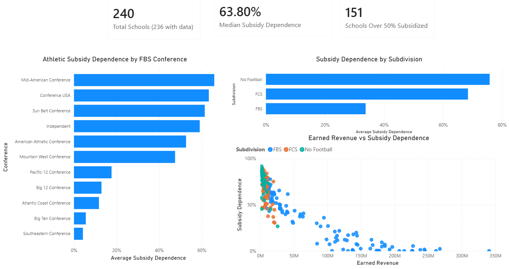

# NCAA Athletic Subsidy Analysis

**[Explore the live interactive dashboard](https://claude.ai/artifact/WoEp5Zd94yTpLMUDduxj1U)**

Most public Division I athletic departments do not pay for themselves. Across 240 public D-I schools in FY2024, the typical school covered only about a third of its athletic revenue with money it earned, and the rest came from student fees and institutional or government support. 151 of the 236 schools with reported financials leaned on subsidies for more than half their athletic funding.

## The question

Which public universities depend most on student fees and subsidies to fund athletics, and how does that dependence vary by subdivision and conference?

## Data

Knight-Newhouse College Athletics Database, pulled through its Custom Reporting export. The set covers 240 public Division I schools for fiscal year 2024, with all dollar figures inflation-adjusted. Four schools have no reported financial figures and are left out of the calculations. Each row is one school-year. Fields include total revenues, media and conference revenue, ticket sales, institutional or government support, and student fees, along with the school's NCAA subdivision and FBS conference.

## Method

The analysis runs in Python with pandas. The script (`analyze_ncaa.py`) reads the Knight-Newhouse export and renames the raw columns to readable names. From those it builds the fields the question needs:

- `subsidy`: institutional or government support plus student fees
- `subsidy_pct`: subsidy divided by total revenues
- `student_fee_pct`: student fees divided by total revenues
- `earned_revenue`: total revenues minus subsidy

Subsidy dependence is the share of athletic revenue that comes from money the department did not earn. Earned revenue is what is left once that support is removed. The script writes `ncaa_analyzed.csv`, which feeds a Power BI dashboard and the interactive dashboard.

## Findings

The median school funds 63.8% of its athletic revenue through subsidies. More than half the schools with reported data, 151 of 236, rely on subsidies for over half their athletic money.

Dependence tracks closely with subdivision. Average subsidy dependence by group:

| Subdivision | Average subsidy dependence |
|---|---|
| FBS | ~34% |
| FCS | ~68% |
| No Football | ~76% |

Conference tells the same story inside FBS. A short list of power conferences fund athletics almost entirely on their own, while the smaller conferences lean heavily on subsidies. Average subsidy dependence:

| Conference | Average subsidy dependence |
|---|---|
| Southeastern (SEC) | ~4% |
| Big Ten | ~6% |
| Atlantic Coast (ACC) | ~12% |
| Big 12 | ~13% |
| Sun Belt | ~61% |
| Conference USA | ~63% |
| Mid-American | ~66% |

## What it means

The data points to one driver: whether a school has a media and ticket business big enough to carry the department. A handful of big-brand programs in the power conferences bring in enough television and gate revenue to run near break-even without touching student money. Everyone else backfills the gap with fees and institutional support, and the smaller the earned-revenue base, the larger that backfill has to be.

The scatter of earned revenue against subsidy dependence shows the relationship directly. Schools fall along an inverse curve. As earned revenue climbs, subsidy dependence drops toward zero, and the schools with almost no commercial athletic revenue sit near 80 to 90% dependence. For most public universities, athletics is not a business that funds itself. It is a service the campus pays to provide, and students cover a real part of the bill.

## Interactive dashboard

**[Explore the live dashboard](https://claude.ai/artifact/WoEp5Zd94yTpLMUDduxj1U)**

I turned the analyzed CSV into an interactive dashboard using Claude Artifacts (React and Recharts). It adds division filters, a revenue source breakdown, conference and division comparisons, a scatter of earned revenue vs. subsidy, and a lookup for any school.

**How I used Claude:** I gave Claude `ncaa_analyzed.csv` and iterated through follow-up prompts for layout, color, filters, and a dark mode toggle, keeping a prompt log of each step.

**What I verified:** I checked every tile, chart, and note against this repo's Python results, and tested the school lookup on a normal case (George Mason) and a missing-data case (Temple). The University of Idaho is tagged Sun Belt in the source data but plays FCS football, so it is excluded from the dashboard's FBS conference chart.

## Repo contents

- `analyze_ncaa.py`: the pandas script that reads the raw export and writes the analyzed CSV
- `ncaa_analyzed.csv`: the processed dataset that feeds both dashboards
- `NCAA_Subsidies.pbix`: the Power BI dashboard
- `dashboard.png`: screenshot of the Power BI dashboard

The raw Knight-Newhouse export is not redistributed here. Pull it yourself from the source below.

## Running it

The analysis was built on a machine with no prior Python install, using uv to manage the environment:
